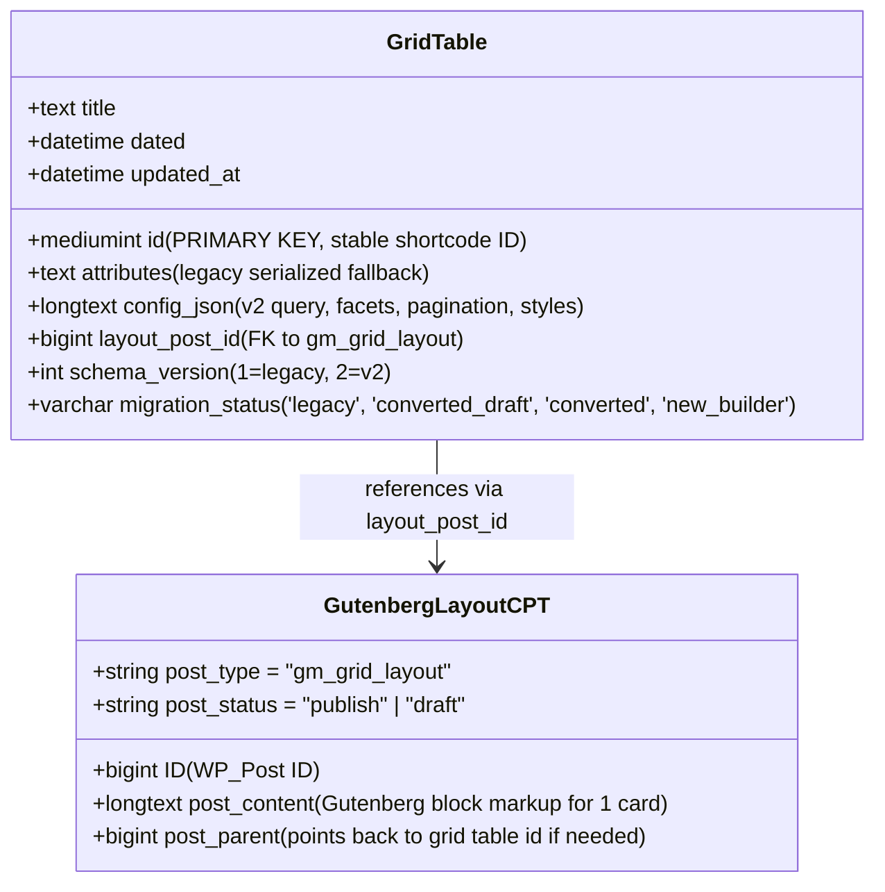

# ADR 0003: GridMaster 2.0 Storage Architecture — Stable Table Identity with Private Gutenberg Layout CPT

**Status:** Approved  
**Date:** 2026-11-04  
**Author:** Antigravity (Lead WordPress Plugin Architect)  
**Deciders:** Core Engineering Team  
**Consulted:** Free & Pro Maintainers  

---

## 1. Context and Problem Statement

GridMaster has historically saved post grids in a custom MySQL table: `{$wpdb->prefix}gridmaster_grids`.
The table structure established in 1.0.0 is:
```sql
CREATE TABLE {$wpdb->prefix}gridmaster_grids (
    id mediumint(9) NOT NULL AUTO_INCREMENT,
    title text NOT NULL,
    attributes text NOT NULL,
    dated datetime DEFAULT NOW(),
    PRIMARY KEY  (id)
);
```
Grid shortcodes rely entirely on these stable numeric IDs:
```
[gridmaster id="123"]
```

For GridMaster 2.0, users must be able to design post cards using the native WordPress Gutenberg editor. Gutenberg's block serialization format (HTML comments with JSON attributes, e.g. `<!-- wp:gridmaster/title /-->`) natively requires post entities (`WP_Post`) to leverage core WordPress systems such as:
1. Native block parsers and renderers (`parse_blocks`, `render_block`).
2. Autosave, draft, and revision history.
3. The WordPress REST API (`/wp/v2/blocks` and post controllers).
4. Standard block locking and permissions.

However, storing entire grids solely as WordPress custom posts (CPTs) creates major problems:
- **ID Collisions:** Existing numeric IDs in `{$wpdb->prefix}gridmaster_grids` (e.g., ID 1, 2, 5) would collide with existing WordPress post IDs, breaking published shortcodes across user sites.
- **Data Fragmentation:** Storing query parameters, facet configuration, responsive styling, and layout data as loose post meta fields results in scattered queries and difficult atomic migrations.

We need a storage architecture that retains 100% shortcode ID stability, provides a clean home for modern grid configuration, and seamlessly integrates with Gutenberg block storage.

---

## 2. Decision: Hybrid Entity Registry

We adopt a **hybrid storage model** that separates identity and grid-level configuration from the Gutenberg block tree.



### 2.1 Authoritative Identity in MySQL Table
The custom database table `{$wpdb->prefix}gridmaster_grids` remains the **authoritative identity registry**:
- The numeric `id` is permanent. `[gridmaster id="123"]` always maps to row 123.
- `title`: The human-readable name of the grid.
- `config_json`: A validated JSON object storing:
  - `query`: Post type, taxonomy filters, author, orderby, order, posts_per_page.
  - `facets`: Array of filter components with placement, type, and options.
  - `pagination`: Pagination type ('numbered', 'load_more', 'infinite', 'none') and settings.
  - `layout`: Responsive columns (xs, sm, md, lg, xl), gap sizing, and container styles.
- `layout_post_id`: The post ID of the associated `gm_grid_layout` CPT.
- `schema_version`: `2` for GridMaster 2.0 grids; `1` for legacy grids.
- `migration_status`: Tracks lifecycle (`legacy`, `converted_draft`, `converted`, `new_builder`).
- `attributes`: Retained untouched for legacy backwards compatibility.

### 2.2 Card Layout in Private CPT
The post card Gutenberg block tree is stored in a private custom post type: `gm_grid_layout`.
```php
register_post_type( 'gm_grid_layout', array(
    'labels'              => array( 'name' => __( 'Grid Layouts', 'ajax-filter-posts' ) ),
    'public'              => false,
    'publicly_queryable'  => false,
    'show_ui'             => false, // Accessed strictly via GridMaster builder
    'show_in_menu'        => false,
    'show_in_rest'        => true,  // Required for Gutenberg block editor
    'capability_type'     => 'post',
    'map_meta_cap'        => true,
    'hierarchical'        => false,
    'exclude_from_search' => true,
    'rewrite'             => false,
    'query_var'           => false,
    'supports'            => array( 'title', 'editor', 'revisions' ),
) );
```
- `post_content` contains standard Gutenberg block HTML for exactly **one card** (e.g. `<!-- wp:gridmaster/card -->...<!-- /wp:gridmaster/card -->`).
- Revisions and autosaves are handled automatically by WordPress core.

### 2.3 Atomic Save & Rollback
When saving or updating a grid in GridMaster 2.0:
1. The builder sends an atomic payload to `/wp-json/gridmaster/v2/grids` containing `title`, `config`, and `block_content`.
2. The REST controller creates or updates the `gm_grid_layout` CPT.
3. The controller updates the `{$wpdb->prefix}gridmaster_grids` table row with `config_json`, `layout_post_id`, `schema_version = 2`, and `updated_at`.
4. If either step fails, database transactions and error handling roll back the changes to prevent orphaned state.

---

## 3. Schema Migration Strategy

The migration is handled idempotently via `GridMaster\DB_Migration`:
- When upgrading to version `2.0.0`, `dbDelta()` adds the missing columns (`config_json`, `layout_post_id`, `schema_version`, `migration_status`, `updated_at`) to `{$wpdb->prefix}gridmaster_grids`.
- Existing rows are NOT modified or deleted during installation/upgrade. All existing rows retain `schema_version = 1` and `migration_status = 'legacy'`.
- Legacy grids continue rendering through the legacy shortcode engine until an administrator explicitly migrates them.

---

## 4. Consequences and Trade-offs

### Advantages
- **Zero Breaking Changes:** Existing shortcodes `[gridmaster id="123"]` retain identical IDs and output.
- **Native Gutenberg Power:** Revisions, block serialization, block validation, and REST API functionality are provided by WordPress core without reinventing an entire page builder storage engine.
- **Clean Configuration Store:** Query and facet settings reside in a single validated `config_json` field rather than dozens of disparate post meta rows.

### Trade-offs & Mitigations
- **Two Database Entities:** A grid has a row in `wp_gridmaster_grids` and a post in `wp_posts`.
  *Mitigation:* The `GridMaster\Grid_Repository` encapsulates all CRUD operations, ensuring that deleting a grid row also cleans up the associated `gm_grid_layout` CPT, preventing orphaned records.
