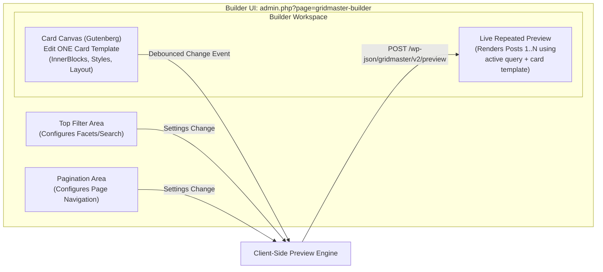

# ADR 0004: Native Gutenberg Post Card Builder & Repeated Preview Architecture

**Status:** Approved  
**Date:** 2026-11-04  
**Author:** Antigravity (Lead WordPress Plugin Architect)  
**Deciders:** Core Engineering Team  
**Consulted:** Free & Pro Maintainers  

---

## 1. Context and Problem Statement

A core goal of GridMaster 2.0 is to deliver a drag-and-drop visual editing experience powered by WordPress's native Gutenberg block editor. Users must be able to design a **single post card layout** and have GridMaster repeat that layout across queried posts.

Prior approaches faced critical challenges:
1. **The Single vs Repeated Mismatch:** In Gutenberg, an editor typically edits what is displayed on the screen. However, a post grid builder requires the user to edit **one template card**, while the preview must display **multiple repeated cards** (e.g. 6 to 12 cards) populated with real database posts.
2. **Context Bleed & Nesting:** When dynamic field blocks (e.g. Post Title, Featured Image) are nested inside core layout blocks (Columns, Groups, Rows), they must correctly inherit the context of the specific post being rendered rather than the global page or template post.
3. **Editor Performance & Re-renders:** Duplicating block editor instances for every repeated card in the editor causes severe browser memory leaks and slow typing latency.

---

## 2. Decision: Single Card Editor Canvas with Live Server-Rendered Repeated Preview

We separate the **interactive editing canvas** from the **live repeated preview**:



### 2.1 The Card Template Canvas
- The user edits exactly **one card layout** inside an isolated Gutenberg block editor mounted on `admin.php?page=gridmaster-builder`.
- The root block is `gridmaster/card`.
- Users can insert any allowed blocks:
  - Custom dynamic fields (`gridmaster/title`, `gridmaster/featured-image`, `gridmaster/excerpt`, `gridmaster/read-more`, `gridmaster/post-date`, `gridmaster/post-author`, `gridmaster/post-terms`, `gridmaster/post-meta`, `gridmaster/comments-count`).
  - Structural blocks (`core/group`, `core/columns`, `core/column`, `core/spacer`, `core/separator`).
- Gutenberg inspector panels provide standard block controls (typography, colors, borders, dimensions, aspect ratios).

### 2.2 Dynamic Block Context API
To ensure dynamic field blocks read the correct post data without global post pollution, all GridMaster dynamic blocks declare:
```json
{
  "name": "gridmaster/title",
  "usesContext": [ "postId", "postType", "gridmaster/gridId" ]
}
```
During runtime and preview rendering:
- The rendering loop iterates over queried posts.
- For each post, the renderer wraps the block tree with a context provider or injects `$block->context['postId'] = $post->ID`.
- Dynamic blocks read post fields directly using their contextual `$block->context['postId']`.
- Global `$post` state is managed cleanly with `setup_postdata()` and `wp_reset_postdata()`, ensuring third-party plugins and core template tags function reliably.

### 2.3 Live Repeated Preview Engine
- Next to or toggleable with the card editor canvas, a **Live Repeated Preview** displays the grid as it will appear on the frontend.
- When blocks, query settings, or styles change, the builder debounces the update (300ms) and calls the preview endpoint:
  `POST /wp-json/gridmaster/v2/preview`
- The preview endpoint executes the configured `WP_Query`, renders the repeated cards using `render_block()`, and returns the compiled HTML and CSS custom properties.
- This approach avoids running dozens of Gutenberg editor instances simultaneously, keeping the editor blazing fast and responsive.

---

## 3. Block Schema Definition

Every GridMaster block follows standard WordPress `block.json` specifications (API Version 3):
- Registered using `register_block_type()` referencing the block directory.
- JavaScript components built using standard `@wordpress/scripts` tooling.
- Server-side render callbacks declared via `render_callback` or `render.php` for bulletproof SSR and dynamic context resolution.

---

## 4. Consequences and Trade-offs

### Advantages
- **Fast, Responsive Editor:** Editing remains smooth because only a single card is in the Gutenberg block tree.
- **Accurate Real-World Preview:** Users see actual post titles, featured images, and dates from their WordPress database across multiple cards.
- **Safe Dynamic Context:** Nested columns and groups work effortlessly without leaking state between adjacent cards.

### Trade-offs
- Preview requires a lightweight REST roundtrip (or local cache).
  *Mitigation:* Pre-caching query results and rendering debouncing ensure near-instantaneous visual feedback.
