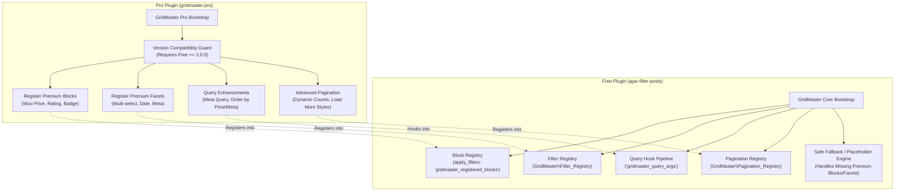

# ADR 0005: Free + Pro Extension Contract & Versioned Extension Points

**Status:** Approved  
**Date:** 2026-11-04  
**Author:** Antigravity (Lead WordPress Plugin Architect)  
**Deciders:** Core Engineering Team  
**Consulted:** Free & Pro Maintainers  

---

## 1. Context and Problem Statement

The GridMaster ecosystem is split into two distinct repositories:
1. **Free Plugin (`ajax-filter-posts`):** The foundational engine providing database storage, the Gutenberg builder shell, standard post card blocks, basic query builder, standard facets, and the rendering runtime.
2. **Pro Plugin (`gridmaster-pro`):** The commercial extension providing advanced facets (multi-select, date ranges, meta filters), premium card blocks (e.g. WooCommerce price/add-to-cart, badges), advanced pagination, and specialized styling presets.

Historically, integration relied on loose PHP filters and direct function overrides. If Free or Pro changed signatures or if Pro was temporarily disabled, errors or missing options occurred.

For GridMaster 2.0, we require a robust, versioned extension contract that guarantees:
- Free functions 100% reliably with zero dependencies on Pro.
- Pro extends Free via explicit, documented registry APIs.
- Deactivating Pro does NOT delete, corrupt, or alter saved premium configuration.
- Missing Pro blocks or facets degrade gracefully into safe placeholders rather than throwing fatal errors.
- Version compatibility checks prevent mismatched installations from executing incompatible hooks.

---

## 2. Decision: Versioned Extension Points and Registries

We establish formal extension registries and lifecycle hooks owned by Free and consumed by Pro.



### 2.1 Version Handshake & Compatibility Guard
Pro defines the minimum required Free version:
```php
define( 'GRIDMASTER_PRO_MIN_FREE_VERSION', '2.0.0' );
```
During `plugins_loaded`, Pro checks if Free is active and meets the version requirement:
```php
if ( ! defined( 'GRIDMASTER_VERSION' ) || version_compare( GRIDMASTER_VERSION, GRIDMASTER_PRO_MIN_FREE_VERSION, '<' ) ) {
    add_action( 'admin_notices', 'gridmaster_pro_free_version_notice' );
    return;
}
```

### 2.2 Extension Points

#### A. Block Registration
Free provides the filter `gridmaster_registered_blocks`:
```php
$blocks = apply_filters( 'gridmaster_registered_blocks', $default_blocks );
```
Pro registers its block directories, extending the builder canvas palette without monkey-patching.

#### B. Filter / Facet Registry (`GridMaster\Filter_Registry`)
Free implements a singleton `Filter_Registry` where filter handlers are registered:
```php
namespace GridMaster;

class Filter_Registry {
    public static function register( $facet_type, $handler_class );
    public static function get( $facet_type );
    public static function get_all();
}
```
Pro registers premium facet handlers (e.g. `multi-select`, `date-range`, `meta-numeric`), each implementing `Facet_Handler_Interface` (`render()`, `sanitize()`, `apply_query()`).

#### C. Query Pipeline
Free runs WP_Query args through:
```php
$query_args = apply_filters( 'gridmaster_query_args', $query_args, $grid_config, $active_facets );
```
Pro safely attaches `meta_query`, custom ordering, or WooCommerce status arguments.

#### D. Pagination Registry (`GridMaster\Pagination_Registry`)
Free registers core pagination types (`numbered`, `load_more`, `infinite`, `none`). Pro can register custom pagination types or styling variations.

### 2.3 Safe Degradation Rules
1. **Pro Deactivated:**
   - If a saved grid contains Pro facet settings in `config_json`, Free skips rendering the unknown facet without modifying or discarding the saved JSON.
   - If the card template references a Pro block (e.g. `gridmaster-pro/product-price`), Free's block renderer checks if the block is registered. If unregistered, it returns an empty string on the frontend and an informative placeholder in the admin builder.
2. **Pro Re-enabled:**
   - Once Pro is reactivated, the previously saved premium blocks and facets resume rendering immediately with zero data loss.

---

## 3. Consequences and Trade-offs

### Advantages
- **Clean Separation of Concerns:** Core engine is 100% self-sufficient.
- **Resilient Configuration:** User data is never deleted due to a temporary plugin deactivation.
- **Extensible for 3rd Parties:** Any third-party developer can create add-ons using the exact same documented registry APIs.

### Trade-offs
- Requires strict interface contracts for facets and blocks.
  *Mitigation:* Formal PHP interfaces (`Facet_Handler_Interface`) and validation utilities enforce type safety across both plugins.
