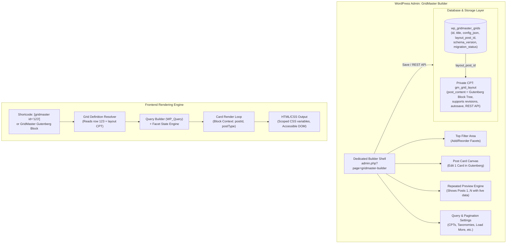

# Product Requirements Document (PRD): GridMaster 2.0

**Document Reference:** PRD-0002 / GM2-PRD  
**Target Version:** GridMaster 2.0.0 (Free) & GridMaster Pro 2.0.0 (Pro)  
**Author:** Antigravity (Lead WordPress Plugin Architect)  
**Status:** Approved Architecture Specification  
**Date:** 2026-11-04  

---

## 1. Problem Statement & Motivation

GridMaster (slug: `ajax-filter-posts`) and its commercial extension `gridmaster-pro` provide WordPress users with post grid displays and AJAX filtering. However, the existing 1.x / 3.4.x architecture exhibits critical limitations:
1. **Rigid Layouts:** Post cards are locked into predefined PHP templates (style-1, style-2, style-3, etc.). Users cannot reorder card elements (e.g., move the author above the title, add a badge over an image, or place the date next to the comments) without writing custom CSS or hacking PHP templates.
2. **Coupled Editor & Runtime:** The current admin builder relies on a legacy jQuery form with hundreds of option inputs, generating a serialized array stored in `{$wpdb->prefix}gridmaster_grids`.
3. **Disjointed Gutenberg Integration:** Prior experimental attempts either created separate custom post types with colliding IDs (`gutenberg-grid-cards`) or attempted to strip database persistence altogether (`no-grid-db`).
4. **Poor Extensibility:** Adding new facets, pagination styles, or custom dynamic fields required touching core classes directly rather than using a versioned plugin hook contract.

### The Solution: GridMaster 2.0
GridMaster 2.0 reimagines the plugin ecosystem by leveraging native WordPress Gutenberg block editor capabilities while preserving the proven, stable database-backed grid management model:
- Users design a **single reusable post card** using native and custom Gutenberg blocks (Title, Featured Image, Excerpt, Read More, Post Meta, Terms, Date, Author, Comments, Container, Columns).
- The grid builder dynamically renders a **live repeated preview** of multiple cards using real queried posts.
- The entire grid definition (query, filters, card layout reference, pagination, responsive breakpoints, styles) is saved in the WordPress database under a **stable numeric ID** (e.g., `123`).
- Grids are embedded anywhere via `[gridmaster id="123"]` or via a native GridMaster Gutenberg block.
- Seamless compatibility with Free alone and Free + Pro.
- Non-destructive migration path for existing legacy grids with instant rollback support.

---

## 2. Architecture & Data Flow

---

## 3. User Personas & User Journeys

### 3.1 Personas
- **Content Creator / Blogger:** Wants to feature recent blog posts in clean, custom 3-column cards with category badges and read-time meta, without coding.
- **Freelance Web Designer / Agency Developer:** Needs to build custom WooCommerce product grids, portfolio showcases, and custom post type archives with multi-taxonomy filtering, exact responsive gaps, and custom brand colors.
- **Site Administrator / Upgrade User:** Has dozens of existing `[gridmaster id="..."]` shortcodes across a production site and needs a 100% safe upgrade path that guarantees zero layout breakage.

### 3.2 User Journeys
- **Journey A: Create New Grid**  
  Admin opens *GridMaster -> Add New Grid*, chooses a starter card template (or blank canvas), sets post type and taxonomy, customizes card elements in Gutenberg, saves, and copies `[gridmaster id="123"]`.
- **Journey B: Drag-and-Drop Card Layout**  
  Admin inserts a Columns block inside the card, drops a Featured Image on the left and Post Title + Excerpt + Read More on the right, adjusts padding, and sees the live preview update instantly.
- **Journey C: Repeated Card Preview**  
  As the card template is modified, the preview immediately repeats the design across the latest 3-6 matching posts from the database, displaying real post thumbnails, titles, and dates.
- **Journey D: Frontend Shortcode Embedding**  
  Admin pastes `[gridmaster id="123"]` into any page, post, or widget. The grid renders identically to the builder preview with responsive columns and fluid gaps.
- **Journey E: Facet & Filtering**  
  User adds a Category checkbox filter and a Search bar. On the frontend, clicking a category immediately filters the grid via AJAX with smooth transitions, debounced search, and URL parameter synchronization.
- **Journey F: Pagination Variants**  
  User switches between Numbered pagination, "Load More" button, and Infinite Scroll. "Load More" appends newly fetched cards without duplicating existing posts or resetting filter state.
- **Journey G: Free + Pro Integration**  
  When GridMaster Pro is activated, premium facets (Multi-select, Date Range, Meta/Custom Field facets) and premium blocks become available in the builder. If Pro is deactivated, saved configurations remain intact and fallback gracefully without fatal errors.
- **Journey H: Legacy Grid Migration**  
  Admin views the GridMaster list, sees an existing grid labeled "Legacy", clicks "Migrate to New Builder", reviews an automatically generated Gutenberg card template matching the old style, tests it in preview, and promotes it to active. A one-click "Rollback" restores the legacy renderer instantly if needed.
- **Journey I: Multiple Independent Grids on One Page**  
  A page contains two different grids (e.g., "Featured Articles" and "Case Studies"). Each grid maintains independent AJAX pagination, facet states, and scoped styles without interfering with the other.

---

## 4. Functional Requirements

### 4.1 Storage & Schema (Free Core)
- **FR-STO-1:** Retain existing MySQL table `{$wpdb->prefix}gridmaster_grids`.
- **FR-STO-2:** Extend schema with:
  - `config_json longtext DEFAULT NULL`: Authoritative JSON document containing query args, facet definitions, pagination settings, responsive breakpoints, and styling tokens.
  - `layout_post_id bigint(20) unsigned DEFAULT 0`: Foreign key referencing the private `gm_grid_layout` CPT.
  - `schema_version int(11) NOT NULL DEFAULT 1`: Identifies configuration format (1 = legacy serialized attributes, 2 = v2 schema).
  - `migration_status varchar(32) NOT NULL DEFAULT 'legacy'`: ('legacy', 'converted_draft', 'converted', 'new_builder').
  - `updated_at datetime DEFAULT CURRENT_TIMESTAMP ON UPDATE CURRENT_TIMESTAMP`.
- **FR-STO-3:** Private CPT `gm_grid_layout`:
  - `public => false`, `publicly_queryable => false`, `show_ui => false` (accessed strictly via GridMaster), `show_in_rest => true`.
  - Supports `editor`, `revisions`, `autosave`.
  - Content stores standard Gutenberg block markup for a single card.
- **FR-STO-4:** Idempotent database upgrade executed via `admin/DB_Migration.php` with zero data loss or rewrite of existing legacy records.

### 4.2 Grid Builder UI (Free Core)
- **FR-BUI-1:** Dedicated admin screen at `admin.php?page=gridmaster-builder`.
- **FR-BUI-2:** Divided into four clear sections:
  1. Header / Top Bar: Grid title, save status, draft/publish toggle, shortcode copy pill, settings drawer toggle.
  2. Top Filter Area: Visual facet manager allowing users to add, reorder, and configure filter controls.
  3. Post Card Canvas: Native Gutenberg block editor instance editing exactly one card layout.
  4. Live Repeated Preview: Real-time rendered preview displaying multiple posts repeated with the active card layout.
- **FR-BUI-3:** REST API endpoints:
  - `GET /wp-json/gridmaster/v2/grids/<id>`: Fetches grid metadata, config JSON, and layout block content.
  - `POST /wp-json/gridmaster/v2/grids`: Creates or updates a grid definition and its associated layout CPT.
  - `POST /wp-json/gridmaster/v2/preview`: Generates repeated HTML preview for supplied query + block tree.

### 4.3 Post Card Blocks & Block Context (Free Core)
- **FR-BLK-1:** Custom post field blocks registered via `block.json`:
  - `gridmaster/card`: Root container for the post card.
  - `gridmaster/featured-image`: Post thumbnail with size, aspect ratio, border radius, link options.
  - `gridmaster/title`: Post title with heading tag (h1-h6, div), font size, color, link option.
  - `gridmaster/excerpt`: Post excerpt or trimmed content with word/character count controls.
  - `gridmaster/read-more`: Customizable button with text, icon, and button styling.
  - `gridmaster/post-date`: Publish or modified date with custom format string.
  - `gridmaster/post-author`: Author avatar, name, and author archive link.
  - `gridmaster/post-terms`: Taxonomy badge list with separator, background, and term link options.
  - `gridmaster/post-meta`: Custom field renderer with key selector and formatting options.
  - `gridmaster/comments-count`: Comment count with zero/one/more text templates.
- **FR-BLK-2:** Core Block Compatibility:
  - Support nesting inside core `core/group`, `core/columns`, `core/separator`, `core/spacer`.
- **FR-BLK-3:** Block Context API:
  - All field blocks declare `"usesContext": ["postId", "postType", "gridmaster/gridId"]`.
  - Dynamic render callbacks read post data strictly from `$block->context['postId']`, preventing state leaks between repeated cards or host pages.

### 4.4 Query Builder (Free Core + Pro Extensions)
- **FR-QRY-1:** Supports query parameters:
  - `post_type`: Single or multiple post types (posts, pages, custom post types).
  - `posts_per_page`: Number of posts per page / load.
  - `orderby` & `order`: Date, title, menu_order, ID, modified, rand, comment_count.
  - `tax_query`: Taxonomy inclusion, exclusion, term selection, operator (IN, AND, NOT IN).
  - `author`: Filter by specific authors.
  - `search`: Keyword search query.
- **FR-QRY-2:** Security & Sanitization:
  - Strict parameter whitelist; raw SQL or unvetted WP_Query arguments are rejected.
  - Extension hook `apply_filters('gridmaster_query_args', $query_args, $grid_config)` allows Pro and addons to modify query arguments securely.

### 4.5 Facet & Filter System (Free Core + Pro Extensions)
- **FR-FCT-1:** Filter Registry `GridMaster\Filter_Registry`:
  - Extensible registry where filter types register their render callbacks, sanitize logic, and query handler.
- **FR-FCT-2:** Free Filter Types:
  - Taxonomy Dropdown (select)
  - Taxonomy Radio buttons
  - Taxonomy Checkboxes
  - Taxonomy Button Bar / Tabs
  - Keyword Search input
  - Reset / Clear Filters button
- **FR-FCT-3:** Pro Filter Types (via Pro Extension):
  - Multi-select facet with tag pills
  - Date Range picker
  - Custom Field / Meta numeric range & selection
  - Dynamic facet count badges (e.g., "WordPress (14)")
- **FR-FCT-4:** Frontend AJAX Engine:
  - Independent state per grid instance using `data-grid-id="gm-123"`.
  - AbortController / stale request cancellation to prevent race conditions during rapid filter changes.
  - URL hash/query sync option for shareable filter states.

### 4.6 Pagination Engine (Free Core + Pro Extensions)
- **FR-PAG-1:** Numbered Pagination: Classic 1, 2, 3... with Next/Prev and accessible ARIA current page markup.
- **FR-PAG-2:** Next / Previous Buttons.
- **FR-PAG-3:** Load More Button: Asynchronously fetches next page and appends cards with duplicate post detection.
- **FR-PAG-4:** Infinite Scroll: Uses IntersectionObserver with debouncing and error retry limits.
- **FR-PAG-5:** Empty & Error States: Accessible messages when no posts match active facets.

### 4.7 Responsive Layout & Styling (Free Core)
- **FR-STY-1:** Responsive CSS Grid layout powered by scoped CSS custom properties:
  - `--gm-columns-xs`, `--gm-columns-sm`, `--gm-columns-md`, `--gm-columns-lg`, `--gm-columns-xl`.
  - `--gm-col-gap`, `--gm-row-gap`.
  - `--gm-card-bg`, `--gm-card-padding`, `--gm-card-border-radius`, `--gm-card-shadow`.
- **FR-STY-2:** Zero global style pollution: all styles scoped to `.gm-grid-wrapper[data-grid-id="..."]`.

### 4.8 Legacy Migration & Rollback (Free Core)
- **FR-MIG-1:** All existing grids display in the GridMaster list with their status (`legacy`).
- **FR-MIG-2:** "Migrate to New Builder" action parses legacy attributes and constructs an equivalent Gutenberg card layout CPT + `config_json`.
- **FR-MIG-3:** Status transitions to `converted_draft` for testing, then `converted` upon approval.
- **FR-MIG-4:** Original legacy `attributes` column is preserved unmodified.
- **FR-MIG-5:** "Rollback to Legacy" action reverts the grid's rendering to the legacy 1.x pipeline instantly without data loss.

---

## 5. Non-Functional Requirements

### 5.1 Security
- Nonce verification on all admin actions and AJAX / REST endpoints.
- Explicit capability check `current_user_can('edit_theme_options')` or `current_user_can('manage_options')` for all management and REST write routes.
- Sanitization of all config JSON attributes using schema validation.
- Contextual output escaping (`esc_html`, `esc_url`, `esc_attr`, `wp_kses_post`) on all rendered markup.
- Prepared SQL statements using `$wpdb->prepare()` for any direct database queries.

### 5.2 Performance & Caching
- Prevention of N+1 queries during repeated card rendering: post data, author info, and thumbnail metadata are primed using `update_post_caches()` prior to loop execution.
- Transients / object cache for compiled grid configuration and CSS tokens.
- Automatic cache invalidation upon saving or updating a grid.
- Zero frontend asset bloat: block editor JavaScript and CSS are only loaded in wp-admin.

### 5.3 Accessibility (a11y)
- Full compliance with WCAG 2.1 Level AA.
- Keyboard navigation across all interactive filter controls and pagination links.
- ARIA live regions (`aria-live="polite"`) announcing query updates and post count changes to screen readers.
- Proper focus management when "Load More" appends new content.
