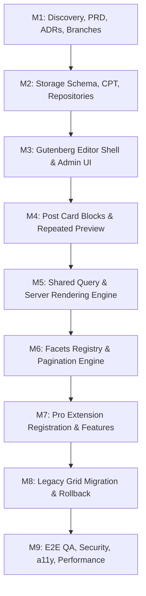

# GridMaster 2.0 — Implementation Plan

**Author:** Antigravity (Lead WordPress Plugin Architect)  
**Date:** 2026-11-04  
**Status:** Approved Master Implementation Plan  
**Target Delivery:** GridMaster 2.0 (Free & Pro)  

---

## 1. Overview & Milestone Roadmap

This document outlines the step-by-step engineering roadmap for executing the GridMaster 2.0 redesign across both `ajax-filter-posts` (Free) and `gridmaster-pro` (Pro).

---

## 2. Milestone Breakdown

### Milestone 1 (M1) — Discovery, PRD, ADRs, and Branch Setup
- **Scope:** Review codebase, research previous experiments (`gutenberg-grid-cards`, `no-grid-db`, `gridmaster`, `free-post-grid`), establish architecture documents, PRDs, ADRs, implementation and migration plans, setup feature branches `feature/gutenberg-grid-builder-v2` in both repos.
- **Affected Repositories:** Free (`ajax-filter-posts`) and Pro (`gridmaster-pro`).
- **Tasks:**
  1. Inspect local WordPress development environment and CLI availability.
  2. Analyze previous branches and document in `docs/redesign/previous-experiments.md`.
  3. Author `docs/prd/gridmaster-v2.md`.
  4. Author `docs/adr/0003-gridmaster-v2-storage.md`, `docs/adr/0004-gutenberg-builder-architecture.md`, `docs/adr/0005-free-pro-extension-contract.md`.
  5. Author `docs/redesign/implementation-plan.md` and `docs/redesign/migration-plan.md`.
  6. Confirm dedicated feature branches in both repositories.
- **Acceptance Criteria:**
  - Complete architecture documentation published in `docs/`.
  - Feature branches active on both repositories from their clean base branches.
  - Initial database backup verified.

---

### Milestone 2 (M2) — Storage Schema, Repositories, and Migration Framework
- **Scope:** Extend MySQL table `wp_gridmaster_grids`, register private layout CPT `gm_grid_layout`, build `Grid_Repository` for CRUD operations, and implement idempotent `DB_Migration`.
- **Affected Repositories:** Free (`ajax-filter-posts`).
- **Tasks:**
  1. Update `admin/DB_Migration.php` to version `2.0.0` with `dbDelta` adding `config_json`, `layout_post_id`, `schema_version`, `migration_status`, `updated_at`.
  2. Implement `inc/Storage/Grid_Repository.php` to handle transactional CRUD operations:
     - `get($id)`: Fetches row + layout CPT content.
     - `save($data)`: Atomically updates or inserts table row and `gm_grid_layout` CPT.
     - `delete($id)`: Removes table row and associated layout CPT.
     - `list_grids($args)`: Lists all grids with pagination and migration statuses.
  3. Register private `gm_grid_layout` custom post type in `inc/Storage/Layout_CPT.php`.
  4. Write automated PHP unit/integration tests verifying:
     - Fresh database installation schema.
     - Existing installation upgrade idempotency.
     - Grid CRUD operations and CPT foreign key cleanup.
- **Acceptance Criteria:**
  - `wp_gridmaster_grids` has modern columns without altering existing rows.
  - `gm_grid_layout` registered with proper capabilities (`manage_options`).
  - Unit tests for `Grid_Repository` pass 100%.

---

### Milestone 3 (M3) — Gutenberg Editor Shell and Grid Management UI
- **Scope:** Dedicated GridMaster management dashboard and full-screen Gutenberg builder interface.
- **Affected Repositories:** Free (`ajax-filter-posts`).
- **Tasks:**
  1. Build modern GridMaster Admin list view at `admin.php?page=gridmaster`:
     - Displays all grids with ID, Title, Status (Legacy / Converted / New), Shortcode pill, Actions (Edit, Duplicate, Delete, Migrate).
  2. Build dedicated builder screen at `admin.php?page=gridmaster-builder&id=<id>`:
     - Header bar with title input, Save draft / Publish buttons, copy shortcode pill, drawer toggles.
     - Sidebar / drawer panels for Query Settings, Facet Manager, Pagination, Responsive Breakpoints.
     - Central Gutenberg canvas mounted using `@wordpress/edit-post` or isolated block editor canvas.
  3. Implement REST API endpoints in `inc/REST/Grids_Controller.php`:
     - `GET /gridmaster/v2/grids/<id>`
     - `POST /gridmaster/v2/grids`
     - `DELETE /gridmaster/v2/grids/<id>`
- **Acceptance Criteria:**
  - Admin can create a new grid, title it, and open the builder.
  - Builder loads without JavaScript console errors.
  - REST API enforces `manage_options` permissions and validates nonces.

---

### Milestone 4 (M4) — Post Card Blocks and Repeated Preview
- **Scope:** Gutenberg post card blocks and the dynamic live repeated preview system.
- **Affected Repositories:** Free (`ajax-filter-posts`).
- **Tasks:**
  1. Implement core card container block: `gridmaster/card`.
  2. Implement dynamic field blocks using `block.json`:
     - `gridmaster/featured-image`
     - `gridmaster/title`
     - `gridmaster/excerpt`
     - `gridmaster/read-more`
     - `gridmaster/post-date`
     - `gridmaster/post-author`
     - `gridmaster/post-terms`
     - `gridmaster/post-meta`
     - `gridmaster/comments-count`
  3. Configure `"usesContext": ["postId", "postType", "gridmaster/gridId"]` across all field blocks.
  4. Support core container blocks (`core/group`, `core/columns`, `core/spacer`, `core/separator`).
  5. Implement `POST /gridmaster/v2/preview` REST endpoint and client-side preview engine:
     - Runs sample query against database.
     - Iterates posts, sets contextual post ID, calls `render_block()`, returns repeated HTML.
     - Updates dynamically as blocks or styling settings are modified in the editor.
- **Acceptance Criteria:**
  - User can drag-and-drop dynamic blocks into a card.
  - Repeated preview shows 3-6 real posts from the database with different titles and thumbnails.
  - Nested columns and groups retain dynamic post context.

---

### Milestone 5 (M5) — Shared Rendering and Query System
- **Scope:** Reusable server-side query builder and frontend rendering pipeline for shortcode and block embeds.
- **Affected Repositories:** Free (`ajax-filter-posts`).
- **Tasks:**
  1. Implement `inc/Engine/Query_Builder.php`:
     - Normalizes query arguments (`post_type`, `posts_per_page`, `orderby`, `order`, `tax_query`, `author`, `s`).
     - Applies whitelist validation and security constraints.
     - Dispatches `apply_filters('gridmaster_query_args', ...)`.
  2. Implement `inc/Engine/Grid_Renderer.php`:
     - Resolves grid by numeric ID from `wp_gridmaster_grids`.
     - Compiles responsive CSS custom properties (`--gm-columns-xs`, gaps, card styles).
     - Renders grid wrapper, top filters container, repeated cards, and pagination.
     - Prime post caches (`update_post_caches`) to eliminate N+1 database queries.
  3. Connect `[gridmaster id="123"]` shortcode to `Grid_Renderer`.
  4. Register frontend `gridmaster/grid` Gutenberg embed block allowing users to pick a saved grid from a dropdown.
- **Acceptance Criteria:**
  - `[gridmaster id="123"]` outputs valid, responsive HTML on the frontend.
  - Queries execute efficiently with primed caches.
  - Styles are scoped to the grid wrapper without global pollution.

---

### Milestone 6 (M6) — Basic Facets and Pagination
- **Scope:** Reusable filter registry, standard Free filters, frontend AJAX engine, and pagination variants.
- **Affected Repositories:** Free (`ajax-filter-posts`).
- **Tasks:**
  1. Implement `inc/Facets/Filter_Registry.php` and `inc/Facets/Facet_Handler_Interface.php`.
  2. Implement standard Free facet handlers:
     - Taxonomy Dropdown (`taxonomy-dropdown`)
     - Taxonomy Radio Buttons (`taxonomy-radio`)
     - Taxonomy Checkboxes (`taxonomy-checkbox`)
     - Category Tabs / Button Bar (`taxonomy-tabs`)
     - Search Input (`search`)
     - Reset Button (`reset`)
  3. Implement `inc/Pagination/Pagination_Registry.php`:
     - Numbered pagination (`numbered`)
     - Previous / Next buttons (`prev-next`)
     - Load More button (`load-more`)
     - Infinite scroll (`infinite-scroll`)
     - None (`none`)
  4. Build modern frontend controller in `assets/js/frontend.js`:
     - Interactivity with `fetch` / REST API.
     - Request cancellation via `AbortController` to eliminate race conditions.
     - URL query param synchronization (`?gm_cat=5`).
     - Screen reader announcements (`aria-live="polite"`).
- **Acceptance Criteria:**
  - Filtering by taxonomy or search updates the grid seamlessly via AJAX.
  - Load More appends posts without duplicates.
  - Numbered pagination navigates pages accurately.
  - Multiple grids on the same page operate completely independently.

---

### Milestone 7 (M7) — Pro Extension Registration and Premium Components
- **Scope:** Implement Pro extension hooks, version check, premium facets, and premium blocks.
- **Affected Repositories:** Pro (`gridmaster-pro`).
- **Tasks:**
  1. Implement Pro version handshake in `gridmaster.php` checking `GRIDMASTER_VERSION >= 2.0.0`.
  2. Register Pro facet handlers via `GridMaster\Filter_Registry`:
     - Multi-select taxonomy facet with tag pills.
     - Date Range picker facet.
     - Meta / Custom field range and selection facets.
     - Dynamic facet counts ("WordPress (12)").
  3. Register Pro blocks via `gridmaster_registered_blocks`:
     - WooCommerce Product Price (`gridmaster-pro/product-price`).
     - WooCommerce Add to Cart button (`gridmaster-pro/add-to-cart`).
     - Custom Badge block (`gridmaster-pro/badge`).
  4. Extend Query Builder via `gridmaster_query_args` to support meta queries and WooCommerce product queries.
  5. Test graceful degradation: deactivating Pro does not crash Free or destroy saved Pro settings.
- **Acceptance Criteria:**
  - Pro features activate seamlessly when Pro is active.
  - Pro deactivation causes zero fatals; settings remain intact.

---

### Milestone 8 (M8) — Legacy Migration and Default Templates
- **Scope:** Migration engine from legacy serialized grids to GridMaster 2.0, default card templates, and rollback.
- **Affected Repositories:** Free (`ajax-filter-posts`) and Pro (`gridmaster-pro`).
- **Tasks:**
  1. Implement `inc/Migration/Legacy_Migrator.php`:
     - Inspects legacy serialized `attributes`.
     - Maps legacy grid styles (default, style-1, style-2, style-3) to pre-built Gutenberg card layouts.
     - Converts legacy query and filter parameters into `config_json`.
     - Creates the corresponding `gm_grid_layout` CPT.
     - Sets `migration_status = 'converted_draft'`.
  2. Add Migration UI in admin list: "Migrate to New Builder" and "Preview & Approve".
  3. Implement "Rollback to Legacy" action: reverts `migration_status` to `'legacy'` and restores legacy renderer without data loss.
  4. Create pre-built starter templates for new grids (Blog Grid, Card Grid, Minimal List, WooCommerce Showcase).
- **Acceptance Criteria:**
  - Legacy grids can be migrated to v2 with a single click.
  - Migrated grids match original visual intent.
  - Rollback instantly restores legacy rendering if needed.

---

### Milestone 9 (M9) — Browser E2E, Performance, Accessibility, and Security Hardening
- **Scope:** Comprehensive automated testing, browser E2E journeys (A through I), performance benchmarking, accessibility audit, security checks.
- **Affected Repositories:** Free (`ajax-filter-posts`) and Pro (`gridmaster-pro`).
- **Tasks:**
  1. Execute automated test suite covering CRUD, migrations, query builders, and facet registry.
  2. Perform browser verification across all 9 journeys (A through I):
     - Journey A: Create New Grid.
     - Journey B: Drag-and-Drop Builder.
     - Journey C: Repeated Card Preview.
     - Journey D: Frontend Shortcode.
     - Journey E: Filtering.
     - Journey F: Pagination.
     - Journey G: Free + Pro Compatibility.
     - Journey H: Legacy Migration & Rollback.
     - Journey I: Multiple Grids Isolation.
  3. Security hardening: Verify nonces, capabilities, SQL preparation, input sanitization, output escaping.
  4. Accessibility check: Keyboard navigation, ARIA attributes, focus management.
  5. Performance check: Confirm zero N+1 queries and measured page load times.
- **Acceptance Criteria:**
  - All test suites pass.
  - All 9 browser journeys verified without console errors.
  - Zero critical security, accessibility, or performance issues.
