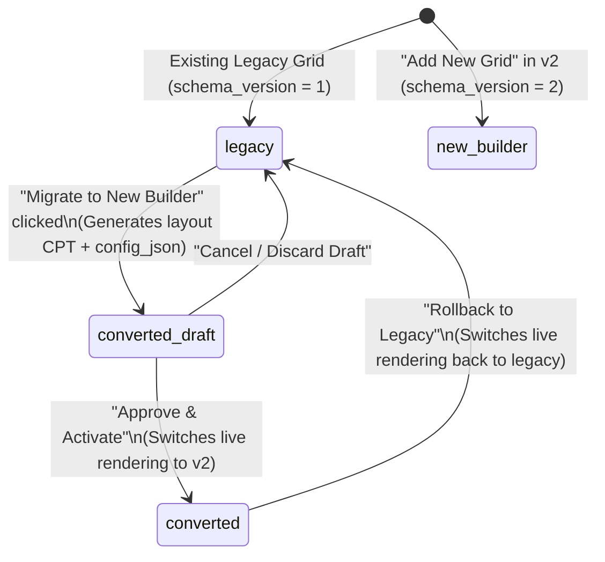

# GridMaster 2.0 — Legacy Grid Migration Plan

**Author:** Antigravity (Lead WordPress Plugin Architect)  
**Date:** 2026-11-04  
**Status:** Approved Migration Specification  
**Scope:** `ajax-filter-posts` (Free) and `gridmaster-pro` (Pro)  

---

## 1. Guiding Principles & Invariant Guarantees

Existing installations of GridMaster have active grids powering production pages via shortcodes like:
```
[gridmaster id="12"]
[am_post_grid id="12"]
[asr_ajax id="12"]
```

The GridMaster 2.0 migration engine guarantees:
1. **Zero Shortcode Breakage:** The numeric grid ID (e.g., `12`) remains unchanged. Shortcodes do not need to be touched or edited.
2. **Zero Destructive Mutation:** The legacy serialized `attributes` column in `{$wpdb->prefix}gridmaster_grids` is NEVER overwritten, cleared, or deleted.
3. **Reversible Migration (Instant Rollback):** Users can test the migrated Gutenberg layout. If any discrepancy is found, a single click rolls the grid back to the legacy renderer immediately.
4. **No Forced Conversion:** Grids remain on the legacy rendering path until an administrator explicitly migrates them.

---

## 2. Migration States and Lifecycle

Each grid record in `{$wpdb->prefix}gridmaster_grids` has a `migration_status` field that governs its lifecycle:



| Migration Status | Meaning | Live Frontend Renderer | Admin Builder Experience |
| :--- | :--- | :--- | :--- |
| `legacy` | Unmigrated legacy grid | Legacy renderer (`Shortcode::render_shortcode`) | Legacy form / Migration notice |
| `converted_draft`| Converted layout generated for review | Legacy renderer (frontend untouched) | New Gutenberg Builder preview |
| `converted` | Approved v2 grid | Modern v2 Gutenberg engine | New Gutenberg Builder |
| `new_builder` | Fresh grid created in v2 | Modern v2 Gutenberg engine | New Gutenberg Builder |

---

## 3. Attribute Translation Map

The `Legacy_Migrator` engine translates legacy serialized attributes into the v2 `config_json` schema and the Gutenberg block tree.

### 3.1 Query Attributes
| Legacy Attribute | v2 `config_json` Target | Default / Notes |
| :--- | :--- | :--- |
| `post_type` | `query.post_type` | `'post'` |
| `posts_per_page` | `query.posts_per_page` | `9` (integer) |
| `orderby` | `query.orderby` | `'date'` |
| `order` | `query.order` | `'DESC'` |
| `taxonomy` | `query.taxonomy` | `'category'` |
| `terms` | `query.terms` | Comma-delimited IDs converted to array of integers |
| `hide_empty` | `query.hide_empty` | Boolean (`true`/`false`) |

### 3.2 Facet / Filter Attributes
| Legacy Attribute | v2 `config_json` Target | Default / Notes |
| :--- | :--- | :--- |
| `show_filter` | `facets[0].enabled` | `'yes'` -> `true` |
| `filter_style` | `facets[0].type` | `'default'` -> `'taxonomy-tabs'` |
| `filter_heading` | `facets[0].heading` | String |
| `btn_all` | `facets[0].show_all` | `'yes'` -> `true` |

### 3.3 Pagination Attributes
| Legacy Attribute | v2 `config_json` Target | Default / Notes |
| :--- | :--- | :--- |
| `paginate` | `pagination.type` | `'yes'` -> `'numbered'`, `'no'` -> `'none'` |
| `pagination_type`| `pagination.type` | `'load_more'` -> `'load_more'`, `'infinite_scroll'` -> `'infinite'` |

### 3.4 Responsive Layout Attributes
| Legacy Attribute | v2 `config_json` Target | Default / Notes |
| :--- | :--- | :--- |
| `grid_item_per_row` | `layout.columns` | `{ xs: 1, sm: 2, md: 3, lg: 3, xl: 3 }` |
| `grid_col_gap` | `layout.column_gap` | Integer in pixels (e.g. `30`) |
| `grid_row_gap` | `layout.row_gap` | Integer in pixels (e.g. `30`) |

---

## 4. Default Legacy Style Layout Templates

When migrating, the engine checks `grid_style` (e.g. `default`, `style-1`, `style-2`, `style-3`) and constructs the corresponding Gutenberg card block tree:

### 4.1 Default Style Template
```html
<!-- wp:gridmaster/card {"padding":20,"borderRadius":8,"backgroundColor":"#ffffff"} -->
  <!-- wp:gridmaster/featured-image {"size":"medium_large","aspectRatio":"16/9","borderRadius":6} /-->
  <!-- wp:gridmaster/title {"tagName":"h3","fontSize":"20px","isLink":true} /-->
  <!-- wp:gridmaster/post-date {"format":"F j, Y"} /-->
  <!-- wp:gridmaster/excerpt {"length":20,"type":"words"} /-->
  <!-- wp:gridmaster/read-more {"text":"Read More"} /-->
<!-- /wp:gridmaster/card -->
```

### 4.2 Style 1 Template (Badge on Image)
```html
<!-- wp:gridmaster/card {"padding":0,"borderRadius":12,"backgroundColor":"#ffffff","boxShadow":"0 4px 12px rgba(0,0,0,0.08)"} -->
  <!-- wp:core/group {"style":{"spacing":{"padding":{"top":"0","bottom":"0","left":"0","right":"0"}}},"layout":{"type":"constrained"}} -->
    <!-- wp:gridmaster/featured-image {"size":"medium_large","aspectRatio":"4/3","borderRadius":"12px 12px 0 0"} /-->
    <!-- wp:gridmaster/post-terms {"taxonomy":"category","style":"badge"} /-->
  <!-- /wp:core/group -->
  <!-- wp:core/group {"style":{"spacing":{"padding":{"top":"16px","bottom":"20px","left":"20px","right":"20px"}}}} -->
    <!-- wp:gridmaster/post-date {"format":"M d, Y"} /-->
    <!-- wp:gridmaster/title {"tagName":"h3","fontSize":"18px","isLink":true} /-->
    <!-- wp:gridmaster/excerpt {"length":15} /-->
    <!-- wp:gridmaster/read-more {"text":"Continue Reading"} /-->
  <!-- /wp:core/group -->
<!-- /wp:gridmaster/card -->
```

---

## 5. Rollback Mechanism

If an admin activates a converted grid but decides to revert:
1. The admin clicks **"Rollback to Legacy"** in the GridMaster dashboard.
2. The server executes:
   ```php
   $wpdb->update(
       "{$wpdb->prefix}gridmaster_grids",
       array( 'migration_status' => 'legacy' ),
       array( 'id' => $grid_id )
   );
   ```
3. The frontend rendering pipeline checks:
   ```php
   if ( 'legacy' === $grid->migration_status ) {
       return $legacy_renderer->render( $grid );
   }
   ```
4. The legacy renderer executes with the original `attributes` data.
5. Zero data is lost, and the converted layout CPT is preserved in draft status in case the admin wants to refine and re-activate it later.
